The project cards list only projects I actively maintain. Archived and unmaintained repositories are omitted from the cards.

The `total (all public)` line includes all public repositories owned by `nao1215`, including forks and archived repositories. The other lines show the individually selected repositories.

<!-- showcase:start -->

<picture><source media="(prefers-color-scheme: dark)" srcset="cards/star-history-dark.svg">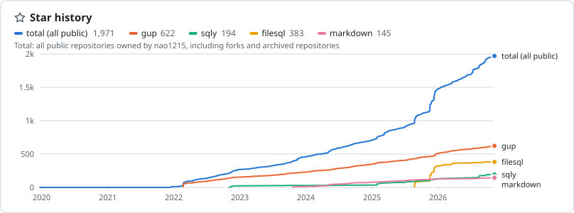</picture>

Gleam, Rust, TypeScript, and GitHub Actions

### Gleam packages

<a href="https://github.com/nao1215/qrkit"><picture><source media="(prefers-color-scheme: dark)" srcset="cards/dark/nao1215__qrkit.svg">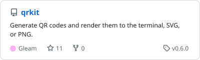</picture></a>
<a href="https://github.com/nao1215/oaspec"><picture><source media="(prefers-color-scheme: dark)" srcset="cards/dark/nao1215__oaspec.svg">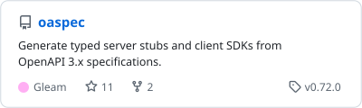</picture></a>

<a href="https://github.com/nao1215/geokit"><picture><source media="(prefers-color-scheme: dark)" srcset="cards/dark/nao1215__geokit.svg">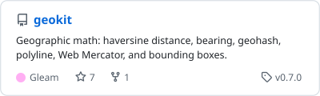</picture></a>
<a href="https://github.com/nao1215/sqlode"><picture><source media="(prefers-color-scheme: dark)" srcset="cards/dark/nao1215__sqlode.svg">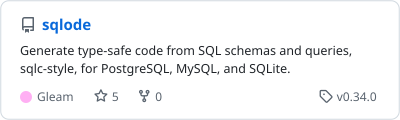</picture></a>

<a href="https://github.com/nao1215/metamon"><picture><source media="(prefers-color-scheme: dark)" srcset="cards/dark/nao1215__metamon.svg">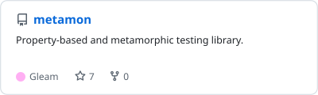</picture></a>
<a href="https://github.com/nao1215/dataprep"><picture><source media="(prefers-color-scheme: dark)" srcset="cards/dark/nao1215__dataprep.svg">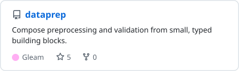</picture></a>

<a href="https://github.com/nao1215/datastream"><picture><source media="(prefers-color-scheme: dark)" srcset="cards/dark/nao1215__datastream.svg">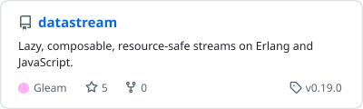</picture></a>
<a href="https://github.com/nao1215/textmetrics"><picture><source media="(prefers-color-scheme: dark)" srcset="cards/dark/nao1215__textmetrics.svg">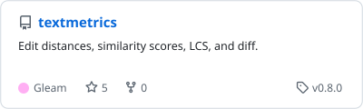</picture></a>

<a href="https://github.com/nao1215/yabase"><picture><source media="(prefers-color-scheme: dark)" srcset="cards/dark/nao1215__yabase.svg">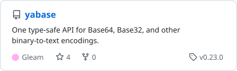</picture></a>
<a href="https://github.com/nao1215/automata"><picture><source media="(prefers-color-scheme: dark)" srcset="cards/dark/nao1215__automata.svg">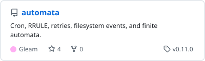</picture></a>

<a href="https://github.com/nao1215/finanza"><picture><source media="(prefers-color-scheme: dark)" srcset="cards/dark/nao1215__finanza.svg">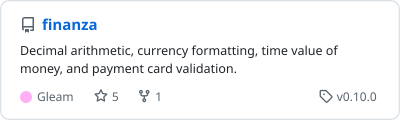</picture></a>
<a href="https://github.com/nao1215/multipartkit"><picture><source media="(prefers-color-scheme: dark)" srcset="cards/dark/nao1215__multipartkit.svg">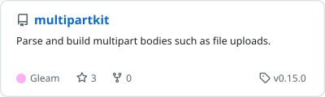</picture></a>

<a href="https://github.com/nao1215/mimetype"><picture><source media="(prefers-color-scheme: dark)" srcset="cards/dark/nao1215__mimetype.svg">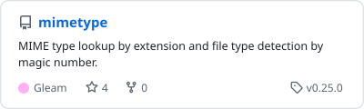</picture></a>
<a href="https://github.com/nao1215/ssevents"><picture><source media="(prefers-color-scheme: dark)" srcset="cards/dark/nao1215__ssevents.svg">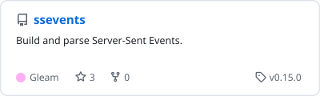</picture></a>

<a href="https://github.com/nao1215/packkit"><picture><source media="(prefers-color-scheme: dark)" srcset="cards/dark/nao1215__packkit.svg">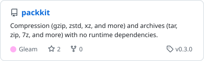</picture></a>
<a href="https://github.com/nao1215/sparklinekit"><picture><source media="(prefers-color-scheme: dark)" srcset="cards/dark/nao1215__sparklinekit.svg">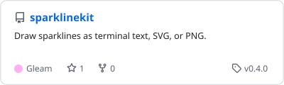</picture></a>

### Rust

<a href="https://github.com/nao1215/truss"><picture><source media="(prefers-color-scheme: dark)" srcset="cards/dark/nao1215__truss.svg">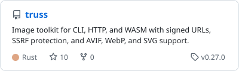</picture></a>
<a href="https://github.com/nao1215/bluesky-terminal-client"><picture><source media="(prefers-color-scheme: dark)" srcset="cards/dark/nao1215__bluesky-terminal-client.svg">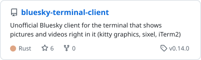</picture></a>

### TypeScript

<a href="https://github.com/nao1215/horcrux"><picture><source media="(prefers-color-scheme: dark)" srcset="cards/dark/nao1215__horcrux.svg">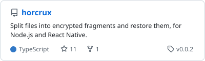</picture></a>

### GitHub Actions

<a href="https://github.com/nao1215/action-readme-showcase"><picture><source media="(prefers-color-scheme: dark)" srcset="cards/dark/nao1215__action-readme-showcase.svg">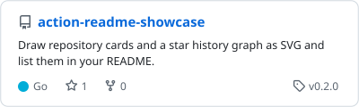</picture></a>
<a href="https://github.com/nao1215/setup-atago"><picture><source media="(prefers-color-scheme: dark)" srcset="cards/dark/nao1215__setup-atago.svg">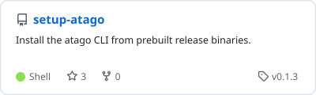</picture></a>

<a href="https://github.com/nao1215/setup-himorime"><picture><source media="(prefers-color-scheme: dark)" srcset="cards/dark/nao1215__setup-himorime.svg">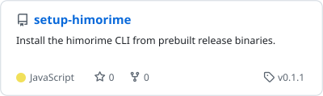</picture></a>
<a href="https://github.com/nao1215/setup-gozen"><picture><source media="(prefers-color-scheme: dark)" srcset="cards/dark/nao1215__setup-gozen.svg">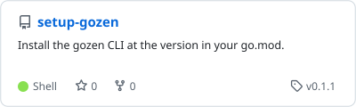</picture></a>

<a href="https://github.com/nao1215/setup-block"><picture><source media="(prefers-color-scheme: dark)" srcset="cards/dark/nao1215__setup-block.svg">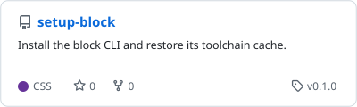</picture></a>
<a href="https://github.com/nao1215/setup-iso8583tool"><picture><source media="(prefers-color-scheme: dark)" srcset="cards/dark/nao1215__setup-iso8583tool.svg">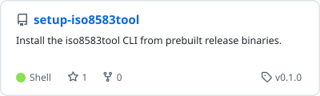</picture></a>

<a href="https://github.com/nao1215/setup-ebitengine"><picture><source media="(prefers-color-scheme: dark)" srcset="cards/dark/nao1215__setup-ebitengine.svg">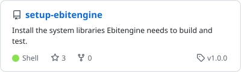</picture></a>

---

### Go CLI tools

<a href="https://github.com/nao1215/gup"><picture><source media="(prefers-color-scheme: dark)" srcset="cards/dark/nao1215__gup.svg">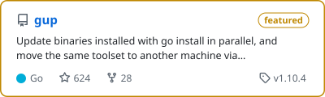</picture></a>
<a href="https://github.com/nao1215/sqly"><picture><source media="(prefers-color-scheme: dark)" srcset="cards/dark/nao1215__sqly.svg">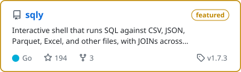</picture></a>

<a href="https://github.com/nao1215/mimixbox"><picture><source media="(prefers-color-scheme: dark)" srcset="cards/dark/nao1215__mimixbox.svg">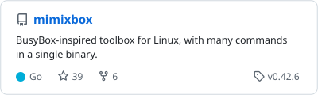</picture></a>
<a href="https://github.com/nao1215/atago"><picture><source media="(prefers-color-scheme: dark)" srcset="cards/dark/nao1215__atago.svg">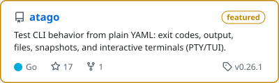</picture></a>

<a href="https://github.com/nao1215/onionscan"><picture><source media="(prefers-color-scheme: dark)" srcset="cards/dark/nao1215__onionscan.svg">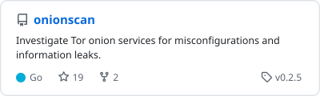</picture></a>
<a href="https://github.com/nao1215/omokage"><picture><source media="(prefers-color-scheme: dark)" srcset="cards/dark/nao1215__omokage.svg">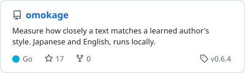</picture></a>

<a href="https://github.com/nao1215/jose"><picture><source media="(prefers-color-scheme: dark)" srcset="cards/dark/nao1215__jose.svg">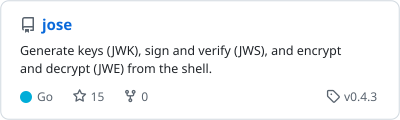</picture></a>
<a href="https://github.com/nao1215/mobilepkg"><picture><source media="(prefers-color-scheme: dark)" srcset="cards/dark/nao1215__mobilepkg.svg">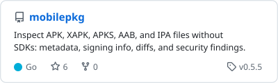</picture></a>

<a href="https://github.com/nao1215/jsonize"><picture><source media="(prefers-color-scheme: dark)" srcset="cards/dark/nao1215__jsonize.svg">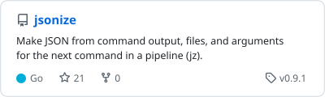</picture></a>
<a href="https://github.com/nao1215/iso8583tool"><picture><source media="(prefers-color-scheme: dark)" srcset="cards/dark/nao1215__iso8583tool.svg">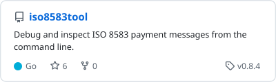</picture></a>

<a href="https://github.com/nao1215/career"><picture><source media="(prefers-color-scheme: dark)" srcset="cards/dark/nao1215__career.svg">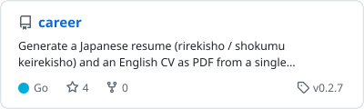</picture></a>
<a href="https://github.com/nao1215/block"><picture><source media="(prefers-color-scheme: dark)" srcset="cards/dark/nao1215__block.svg">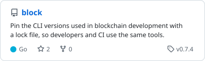</picture></a>

<a href="https://github.com/nao1215/himorime"><picture><source media="(prefers-color-scheme: dark)" srcset="cards/dark/nao1215__himorime.svg">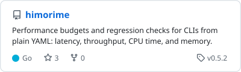</picture></a>

### Go libraries

<a href="https://github.com/nao1215/filesql"><picture><source media="(prefers-color-scheme: dark)" srcset="cards/dark/nao1215__filesql.svg">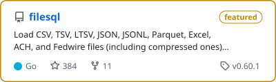</picture></a>
<a href="https://github.com/nao1215/markdown"><picture><source media="(prefers-color-scheme: dark)" srcset="cards/dark/nao1215__markdown.svg">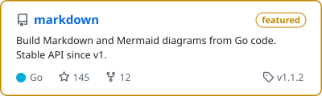</picture></a>

<a href="https://github.com/nao1215/prompt"><picture><source media="(prefers-color-scheme: dark)" srcset="cards/dark/nao1215__prompt.svg">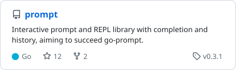</picture></a>
<a href="https://github.com/nao1215/imaging"><picture><source media="(prefers-color-scheme: dark)" srcset="cards/dark/nao1215__imaging.svg">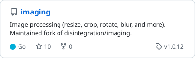</picture></a>

<a href="https://github.com/nao1215/tornago"><picture><source media="(prefers-color-scheme: dark)" srcset="cards/dark/nao1215__tornago.svg">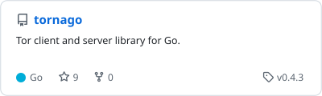</picture></a>
<a href="https://github.com/nao1215/sensitive"><picture><source media="(prefers-color-scheme: dark)" srcset="cards/dark/nao1215__sensitive.svg">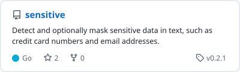</picture></a>

### Games with Ebitengine

<a href="https://github.com/nao1215/rabbitrun"><picture><source media="(prefers-color-scheme: dark)" srcset="cards/dark/nao1215__rabbitrun.svg">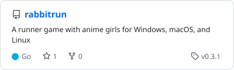</picture></a>
<a href="https://github.com/nao1215/succubus-live"><picture><source media="(prefers-color-scheme: dark)" srcset="cards/dark/nao1215__succubus-live.svg">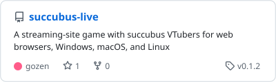</picture></a>

<a href="https://github.com/nao1215/gozen"><picture><source media="(prefers-color-scheme: dark)" srcset="cards/dark/nao1215__gozen.svg">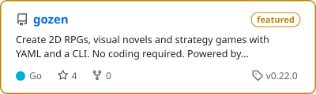</picture></a>

<!-- showcase:end -->

Cards and the star history graph are generated by [action-readme-showcase](https://github.com/nao1215/action-readme-showcase).
